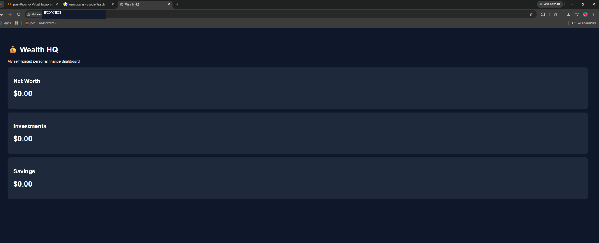
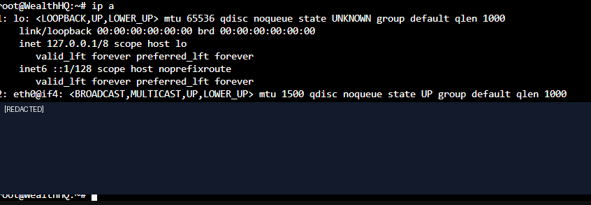
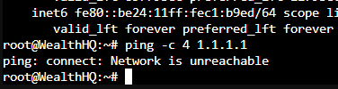
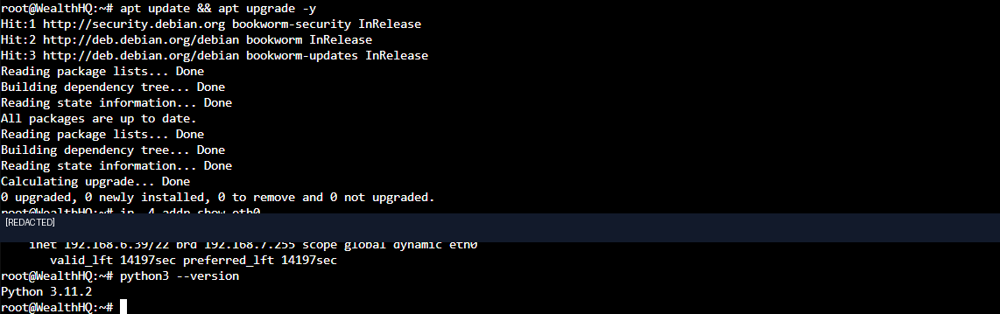
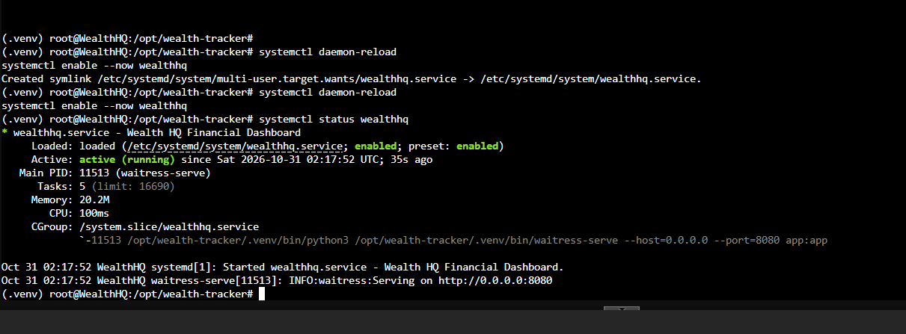
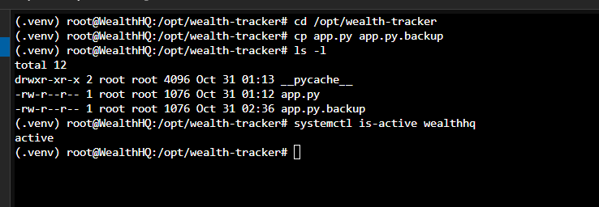

# Wealth HQ — Self-Hosted Financial Dashboard

**Status:** Working prototype | **Environment:** Proxmox VE, Debian 12 LXC, Python 3.11, Flask, Waitress, systemd



*Working browser-based prototype on a Debian LXC container. Balances shown are placeholders.*

## Goal
Create a lightweight financial dashboard on my own home server, accessible from my Windows PC. The eventual goal is a password-protected application for tracking balances, debts and savings goals, with optional scheduled updates and an AI assistant. Those later capabilities are **not implemented yet**.

## Architecture
```text
Windows PC / Browser
       |
  Home LAN (HTTP :8080, prototype only)
       |
Proxmox VE host
       |
Debian 12 LXC (WealthHQ)
       |
systemd wealthhq.service
       |
Waitress WSGI server
       |
Python Flask app (app.py)
```

## What I completed
1. Created a Debian 12 LXC container with a virtual network interface on Proxmox's `vmbr0` bridge.
2. Diagnosed an initial failure installing Debian packages. `apt` reported temporary name-resolution failures.
3. Checked `ip a` and found an operational `eth0` interface with IPv6 addresses but **no IPv4 address**. A ping to an external IPv4 address returned `Network is unreachable`.
4. Found that IPv4 was set to **Static** without an assigned address. Changed it to **DHCP**, restarted the container, and confirmed an IPv4 lease and working package repositories.
5. Updated Debian and installed Python, `python3-venv`, Flask and Waitress in a virtual environment at `/opt/wealth-tracker/.venv`.
6. Built and opened a simple Flask dashboard with placeholder Net Worth, Investments and Savings cards from a browser on my local network.
7. Configured a `systemd` service to run the app under Waitress automatically; confirmed `active (running)` and `enabled`.
8. Created an initial copy of `app.py` as `app.py.backup` before planning the authentication update.

## Troubleshooting lesson: DHCP vs static IPv4

### Initial diagnosis





The virtual NIC was **UP**, but selecting Static without specifying an IPv4 address meant the guest did not request one automatically. Consequently, it could not reach an IPv4 internet destination. IPv6 SLAAC independently assigned IPv6 addresses; that did not guarantee working IPv4 routing or DNS. Using DHCP provided the guest with an IPv4 lease and appropriate configuration for the network.

### Verification after the fix




## Commands I practiced
```bash
ip a
ip -4 addr show eth0
ping -c 4 1.1.1.1
getent hosts deb.debian.org
apt update && apt upgrade -y
python3 --version
python3 -m venv .venv
source .venv/bin/activate
pip install flask waitress
systemctl daemon-reload
systemctl enable --now wealthhq
systemctl status wealthhq
cp app.py app.py.backup
ls -l
```

## Deployment verification

The dashboard was deployed behind Waitress and configured as a systemd service. I verified the service was enabled and running:



Before changing the application for authentication, I created a backup of the working Python source and checked the service again:



## Security / limitations
The prototype is unauthenticated and uses plain HTTP on a local network. It displays **placeholder balances**, not live banking information. It must not be exposed via port forwarding or used for real financial records yet. Account integration, a durable database, secure HTTPS access, and the AI assistant are future work.

## Next steps
- Add authentication using password hashes, sessions, and HTTPS
- Add SQLite persistence with appropriate permissions and backups
- Implement editable accounts, debts, goals and net-worth calculations
- Add read-only data integrations only after security is in place
- Add scheduled monitoring and optionally an AI assistant

## Skills demonstrated
LXC provisioning, Linux command line, IPv4/IPv6 networking, DHCP troubleshooting, Linux package management, Python virtual environments, Flask deployment, WSGI hosting, service management, troubleshooting documentation and operational backups.
